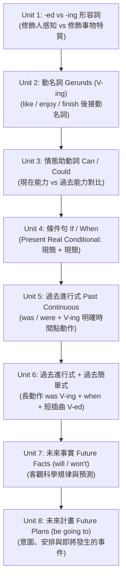

# Oxford Discover 3 — 學生課本全書課程總綱與教研藍圖 (00_Overview.md)

> **【教材基本檔案】**
> - **教材名稱**：Oxford Discover Level 3 (Student Book)
> - **出版機構**：Oxford University Press (OUP)
> - **適用對象**：國小六年級上學期進階英語（雙語班 / 資優選拔 / 私中特訓）
> - **語言能力對標**：CEFR A2 頂標 ➔ 銜接 B1 初級（對標全民英檢 GEPT 初級滿分、劍橋主流英語 Cambridge KET / Flyers）
> - **教材結構**：全書共 82 頁，包含 4 大探究主題（Big Questions）、8 大精讀單元（Units）、4 個單元總複習（Wrap Up & Projects）

---

## 一、全書課程架構與單元對照表 (Scope and Sequence)

| Big Question (探究主題) | Unit (單元) | 頁碼 | 閱讀主題與體裁 | 核心單字群 (10 核心 + 語境詞) | 核心文法句型 (Grammar Focus) | 聽口與寫作技能 |
| :--- | :--- | :---: | :--- | :--- | :--- | :--- |
| **BQ 1: How do people have fun?** (Social Studies: Culture) | **Unit 1: Having Fun** | p.6 | Photo Essay (Nonfiction) 策略：Identify Facts | festival, folk dance, wedding, family reunion, fair, race, team, winner, score, player | **Adjectives with -ed and -ing** - The race was *exciting*. - I am *excited*. | **聽口**：埃及與世界婚禮對比 **寫作**：時間副詞使用 (On Monday...) |
| | **Unit 2: The Red Rubber Ball** | p.16 | Realistic Fiction (Story) 策略：Main Idea | kick, tag, skip, bounce, drop, plain, lake, canyon, cliff, stream | **Gerunds (動名詞當受詞)** - Friends like *skipping*. - Maria likes *landing* on one foot. | **聽口**：最喜愛的戶外遊戲 **寫作**：疑問句造句 (Questions) |
| | **Wrap Up 1** | p.24 | Project: 戲劇劇本改寫 (Write a Play) 與大單元文化探究總結 | | | |
| **BQ 2: Why do people move to new places?** (Social Studies: Geography) | **Unit 3: Letters to a Friend** | p.26 | Letters (Fiction) 策略：Sequence of Events | packing, moving, meeting neighbors, shopping, ice skating, fishing, raking leaves, dancing, throwing snowballs, sledding | **Can and Could for Ability** - Sati *can* ice skate now. - Sati *couldn't* ice skate before. | **聽口**：家庭遷徙訪談 **寫作**：對比轉折連接詞 (Using But) |
| | **Unit 4: Moving from Here... to There!** | p.36 | Magazine Article (Nonfiction) 策略：Details | country, suburb, rural area, urban area, shopping mall, university, hospital, factory, clinic, zoo | **Present Real Conditional (真實條件句)** - *If* I'm sleepy, I run to the park. - *When* a city has good services, people move there. | **聽口**：移民經驗訪談 **寫作**：原因子句 (Using Because) |
| | **Wrap Up 2** | p.44 | Project: 撰寫移民信件 (Write a Letter) 與地理環境比較海報 | | | |
| **BQ 3: Why do people write poems?** (Social Studies: Culture) | **Unit 5: Three Poets** | p.46 | Poems (Fiction) 策略：Theme | ladybug, cricket, grasshopper, beetle, katydid, bee, butterfly, thidwick, kangaroo, raisin | **Past Continuous (過去進行式)** - What *were they doing* yesterday? - They *were sitting* at a table. | **聽口**：為什麼詩人要寫詩？ **寫作**：形容詞排序 (Adjective Order) |
| | **Unit 6: You Can Be a Poet** | p.56 | Instructional Text (Nonfiction) 策略：Visualize | sentence, rhyming words, verb, noun, adjective, syllable, letter, robin, angelfish, snowflakes | **Past Continuous and Simple Past** - I *was walking* to school *when* I saw a butterfly. | **聽口**：自創童詩朗誦 **寫作**：動作動詞精準替換 (Action Verbs) |
| | **Wrap Up 3** | p.64 | Project: 寫一首詩並在班級朗讀 (Write a Poem and Paragraph) | | | |
| **BQ 4: How do we measure time?** (Earth Science) | **Unit 7: Time and the Earth** | p.66 | Internet Article (Nonfiction) 策略：Diagrams | second, minute, hour, month, year, noon, spin, orbit, time zone, multiply | **Future Facts with Will (未來事實)** - It *will be* noon where you live. - It *won't be* noon on the other side. | **聽口**：全球時區天氣預報廣播 **寫作**：定冠詞精確用法 (Definite Article The) |
| | **Unit 8: Doctor Molly** | p.76 | Realistic Fiction (Story) 策略：Problem & Solution | airport, passenger, passport, destination, sick, earache, headache, fever, doctor, medicine | **Future Plans with Going To (未來計畫)** - I'm *going to take* care of you all day. - Are you *going to travel* tomorrow? | **聽口**：機場與醫療求助廣播 **寫作**：專有名詞大寫規範 (Capitalization) |
| | **Wrap Up 4** | p.84 | Project: 度假景點旅遊報告與海報製作 (Write a Report) | | | |

---

## 二、全書語法核心遞進線 (Grammar Progression Roadmap)

本冊語法設計由淺入深，嚴格對標小六銜接國中的時態與句型核心：

---

## 三、AI 出題與教研規範指引 (AI Instruction Guidelines)

1. **嚴守當前單元邊界**：
   - 當學童在練習某一單元時，AI 出題用詞嚴格鎖定該單元前進範圍內的詞彙與文法。
   - **禁止超前混淆**：例如在 Unit 1 測驗中，嚴禁出現 Unit 5 的過去進行式（was/were doing）作為干擾項。
2. **段考與全民英檢考點滲透**：
   - 小六段考必考陷阱：
     - `-ed` 形容詞（修飾感到...的人）與 `-ing` 形容詞（修飾令人...的事物）的混淆。
     - 動名詞作受詞（enjoy watching 而非 enjoy to watch）。
     - When / While 連接詞後的時態一致性。
     - Will 與 Be going to 在語氣（即時決定 vs 事先規劃）上的細微差異。
3. **單元檔案索引**：
   - [Unit 01: Having Fun](file:///C:/@植善課業/AI/英語學習網頁/六年級上/課本/01_Oxford_Discover_3/Unit_01_Having_Fun.md)
